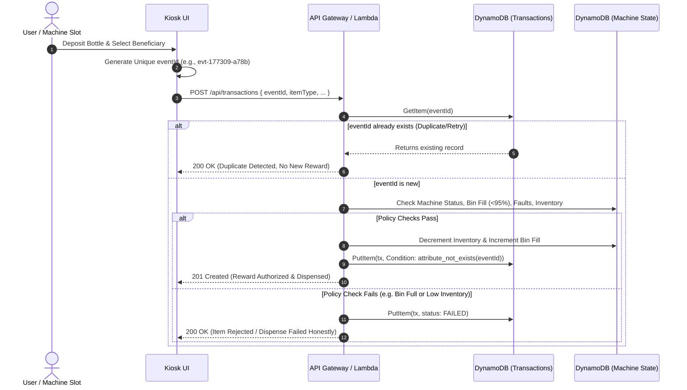

# ReCycle2Feed — Cloud & Software Architecture

## 1. Executive Architectural Overview

ReCycle2Feed is an IoT-enabled, serverless reverse-vending and social reward platform designed for the **Waste and Energy** track of the **Bharat Builds Tour / Environmental Hacks 2026**.

The system connects physical waste segregation (PET bottles and aluminium cans) with measured community animal welfare and food assistance. The software architecture is designed with three core tenets:

1. **Guaranteed Idempotency:** Zero duplicate rewards from browser refreshes, network retries, or repeated sensor triggers.
2. **Deterministic Dual Mode:** Seamless switching between an in-browser client simulation mode (zero cloud credentials required) and a live AWS Serverless cloud deployment.
3. **Transparent Auditing:** Absolute separation between simulated events and physically verified hardware telemetry.

---

## 2. End-to-End Architecture Diagram

```mermaid
flowchart TD
    subgraph Client & Edge Layer
        User[Public User / Caretaker]
        KioskUI[React + TypeScript Kiosk UI]
        ESP32[ESP32 IoT Controller / Edge Hardware]
        SimEngine[In-Browser Deterministic Simulator]
    end

    subgraph AWS Cloud Ingress & Compute Layer
        CloudFront[Amazon CloudFront / Amplify]
        APIGW[Amazon API Gateway HTTP API v2]
        Lambda[AWS Lambda Handler - Node.js 20.x ARM64]
    end

    subgraph AWS Storage & State Layer
        DDB_Tx[(Amazon DynamoDB: Transactions Table)]
        DDB_Mach[(Amazon DynamoDB: Machines Table)]
        DDB_Maint[(Amazon DynamoDB: Maintenance Table)]
        CW[Amazon CloudWatch Structured Logs & Metrics]
    end

    User -->|Interacts| KioskUI
    ESP32 -->|Mutual TLS MQTT / HTTPS| APIGW
    KioskUI -->|Simulation Mode| SimEngine
    KioskUI -->|AWS Cloud Mode| APIGW
    CloudFront -->|Hosts Static Assets| KioskUI
    APIGW -->|Proxy /{proxy+}| Lambda
    Lambda -->|ConditionExpression: attribute_not_exists| DDB_Tx
    Lambda -->|Get / Update State & Inventory| DDB_Mach
    Lambda -->|Audit Log| DDB_Maint
    Lambda -->|Telemetry & Alarms| CW
```

---

## 3. Component Breakdown

### 3.1 Client Layer
* **Framework:** React 18 with TypeScript and Vite.
* **Styling:** Tailwind CSS with a sustainability-technology palette (Forest Green `#1B4332`, Off-White Paper `#FBFBF9`, Charcoal text `#1E252B`, and Emerald accents).
* **State Management:** React Context (`AppContext`) supporting real-time toggling between `SIMULATION` and `AWS` modes.
* **Deterministic Storage:** When running in `SIMULATION` mode, state is preserved in browser `localStorage`, executing the identical business validation rules as the serverless backend.

### 3.2 Ingress Layer (Amazon API Gateway)
* **Type:** HTTP API (v2) for low latency (~10ms) and minimal cost ($1.00/million requests, within AWS Free Tier).
* **CORS:** Configured for `GET`, `POST`, `OPTIONS` with preflight caching.
* **SSL/TLS:** Automated certificate management via Amazon Certificate Manager (ACM).

### 3.3 Compute Layer (AWS Lambda)
* **Runtime:** Node.js 20.x on AWS Graviton2 (`arm64`) for high compute efficiency and cost reduction.
* **Architecture:** Single-dispatch router routing `/api/health`, `/api/config`, `/api/transactions`, `/api/impact`, `/api/machines`, and `/api/maintenance`.
* **Idempotency Engine:** Prevents duplicate reward issuance using deterministic event hash checks before invoking inventory mutation routines.

### 3.4 Storage Layer (Amazon DynamoDB)
Three dedicated tables provisioned in On-Demand (`PAY_PER_REQUEST`) capacity:

1. **`recycle2feed-transactions-prod`:**
   * Partition Key: `eventId` (String, UUID/SHA-256)
   * Global Secondary Index 1: `machineId` (HASH) + `createdAt` (RANGE)
   * Global Secondary Index 2: `dateKey` (HASH) + `createdAt` (RANGE)
   * *Safety:* Conditional writes ensure that an existing `eventId` cannot be overwritten.
2. **`recycle2feed-machines-prod`:**
   * Partition Key: `machineId` (String)
   * Attributes: `displayName`, `locationLabel`, `recyclingBinFillPercent`, `foodInventoryGrams`, `activeFaults`, `lastHeartbeatAt`.
3. **`recycle2feed-maintenance-prod`:**
   * Partition Key: `maintenanceId` (String)
   * Global Secondary Index: `machineId` (HASH) + `createdAt` (RANGE)

---

## 4. Idempotency & Abuse Prevention Protocol



---

## 5. AWS Free Tier Compliance

The entire cloud backend is engineered to run within the **AWS Free Tier** limits ($0 out-of-pocket):
* **API Gateway HTTP API:** 1 million calls/month free for the first 12 months.
* **AWS Lambda:** 1 million requests/month and 3.2 million seconds of compute time always free.
* **Amazon DynamoDB:** 25 GB of storage, 25 WCU, and 25 RCU always free.
* **Amazon CloudWatch:** 5 GB of log ingestion, 10 custom metrics always free.
